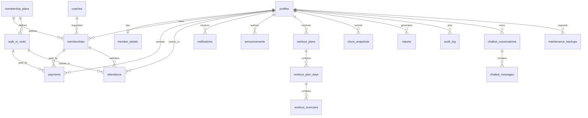

# FITMETRICS database

The application schema is applied after [`supabase/schema.sql`](../supabase/schema.sql),
which owns Supabase Auth integration and `profiles`. All business transactions are
performed at the gym front desk. GCash, Maya, and bank transfer are recorded as
payment methods, not online checkout flows.

## Entity relationship diagram

## Tables

- `profiles`: existing Auth-linked identity, role, and account status.
- `member_details`: member code, student flag, address, join date, notes, and
  emergency-contact relationship.
- `coaches`: external coach contacts. This is not an authentication role.
- `membership_plans`: admin-managed walk-in and duration-based plan catalog,
  including student pricing and whether the plan may create an account.
- `promos`: future configurable fixed or percentage discounts. No promotions
  are seeded initially.
- `walk_in_visits`: anonymous Session/Walk-In customers without Auth accounts.
- `memberships`: paid member access periods. `start_date` is the payment date;
  the backend computes `end_date` from the plan duration.
- `payments`: immutable member or walk-in payment records with receipt numbers,
  PayMongo identifiers, discounts, and lifecycle status. Corrections use
  voiding and a reason rather than deletion.
- `paymongo_webhook_events`: idempotency and audit record for provider events.
- `attendance`: front-desk check-in/check-out sessions for members or walk-ins.
- `notifications`: per-user read/unread in-app notifications.
- `announcements`: admin-authored, role-targeted, publishable and expiring notices.
- `workout_plans`, `workout_plan_days`, `workout_exercises`: informational,
  staff-authored routines requested by the client. They are not medical advice,
  diagnosis, treatment, or an automatic health-plan generator.
- `video_tutorials`: categorized exercise videos with public/hidden visibility.
- `churn_snapshots`: versioned risk snapshots and inactivity evidence.
- `email_log`, `email_queue`: delivery history and retryable email work.
- `ai_insights`: cached structured AI explanations of aggregate metrics.
- `prediction_snapshots`: explainable attendance, revenue, and renewal estimates.
- `reports`: generated report metadata and result payloads.
- `gym_settings`: the single-row gym identity, hours, notification, reminder,
  and maintenance configuration.
- `audit_log`: sensitive operational action history.
- `chatbot_conversations`, `chatbot_messages`: admin-scoped AI conversation history.
- `maintenance_backups`: admin-visible backup request/status records. Actual
  backup execution remains an external Supabase/platform operation.

## Rules enforced in SQL

- Every application table has RLS enabled.
- Members can read only their own member, membership, attendance, billing,
  notification, workout, and analytics rows.
- Clerks can operate on member registration, memberships, payments, attendance,
  and notifications, but cannot edit plans, settings, analytics snapshots, or
  roles/statuses.
- Admins can manage configuration, plans, analytics, reports, and staff actions.
- A member cannot have two open attendance sessions.
- Memberships can be expired by `expire_memberships()`.
- Payment receipt numbers are generated by a database sequence.
- Payment rows are not deleted; voiding requires a reason.
- Session/Walk-In plans cannot create member accounts or member memberships.
- `member_billing_history`, `attendance_daily_summary`,
  `revenue_daily_summary`, and `member_attendance_summary` expose reporting data
  without duplicating aggregates.
